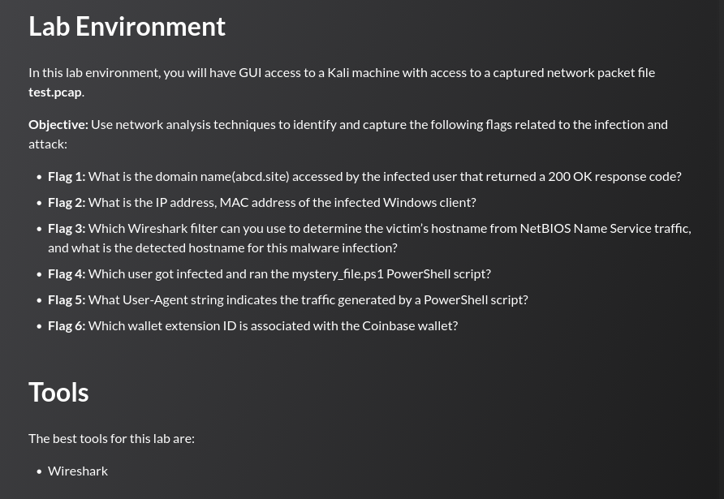
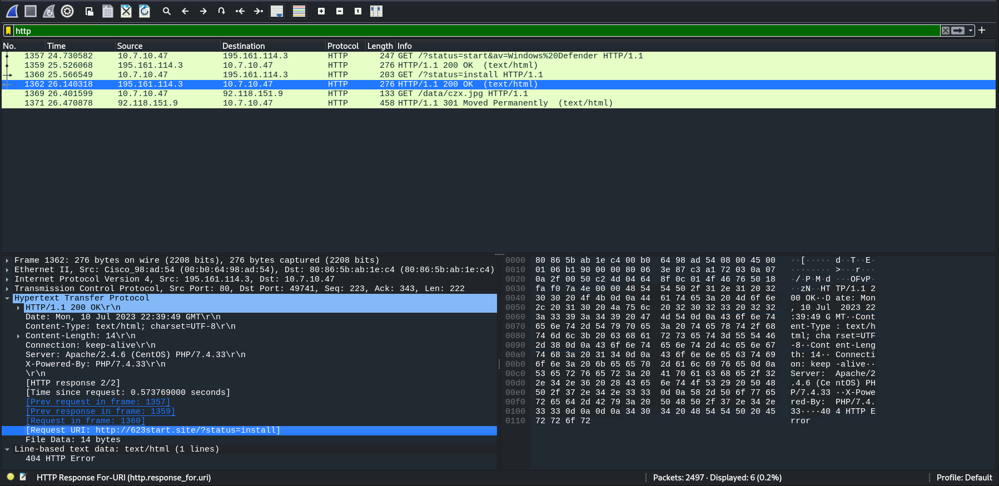
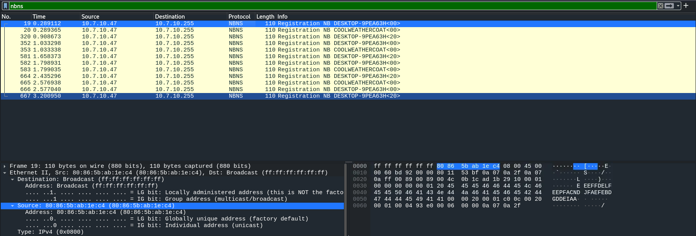
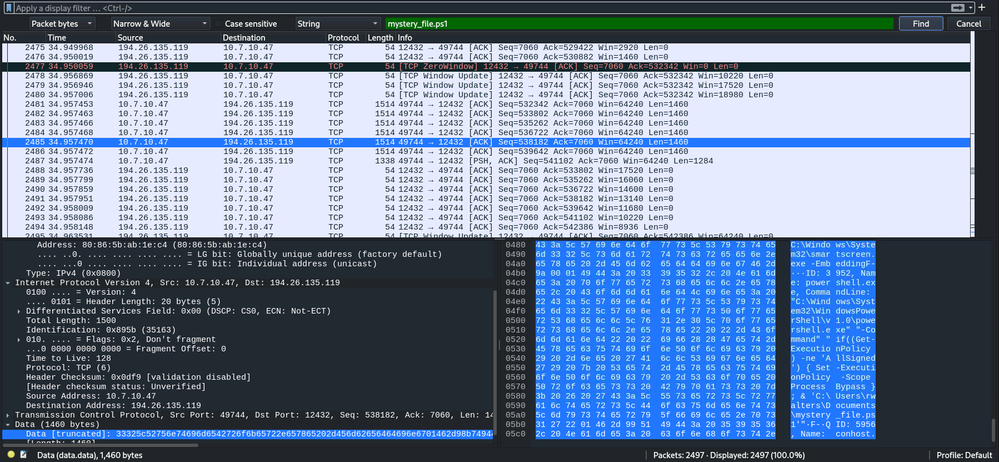
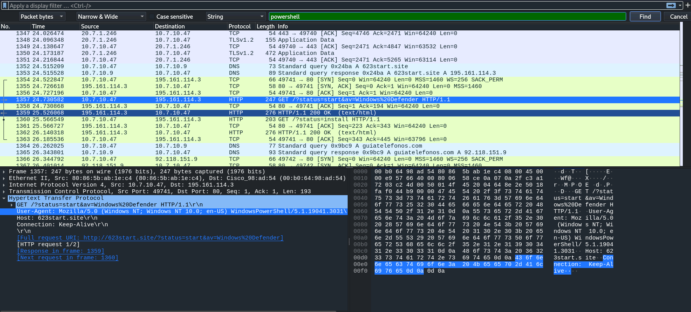
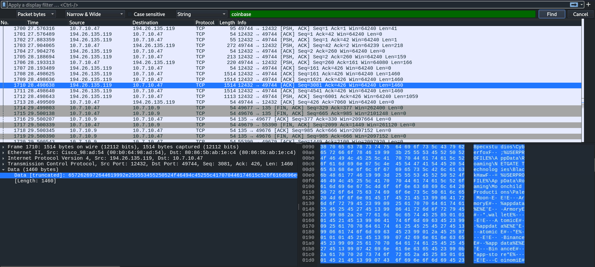

## Task



---
## Flag 1

> _What is the domain name (abcd.site) accessed by the infected user that returned a 200 OK response code?_

Filtering HTTP traffic in Wireshark and inspecting responses for `200 OK` status codes reveals requests made to an external domain. The GET requests to `/?status=start&av=Windows%20Defender` and `/?status=install` both return `200 OK` from the same host:



```
623start.site
```

---
## Flag 2

> _What is the IP address and MAC address of the infected Windows client?_

The infected client is the consistent source of all outbound malicious HTTP and C2 traffic. Its IP and hardware address are visible in any packet originating from it:


```
IP: 10.7.10.47
MAC: 80:86:5b:ab:1e:c4
```

---
## Flag 3

> _Which Wireshark filter can you use to determine the victim's hostname from NetBIOS Name Service traffic, and what is the detected hostname for this malware infection?_

Applying the `nbns` display filter isolates NetBIOS Name Service broadcast registration packets. The infected machine broadcasts its own hostname to `10.7.10.255` (the subnet broadcast address), revealing the Windows computer name:



```
Filter : nbns
Hostname: DESKTOP-9PEA63H
```

---
## Flag 4

> _Which user got infected and ran the mystery_file.ps1 PowerShell script?_

Using Wireshark's packet-bytes search (`Ctrl+F → Packet Bytes → String`) and searching for `mystery_file.ps1` reveals a TCP data payload containing the full PowerShell command line executed on the victim:



```
CommandLine: "C:\Windows\System32\WindowsPowerShell\v1.0\powershell.exe"
             "-Command" "... & 'C:\Users\rwalters\Documents\mystery_file.ps1'"
```

```
rwalters
```

---
## Flag 5

> _What User-Agent string indicates the traffic generated by a PowerShell script?_

Using Wireshark's packet-bytes search (`Ctrl+F → Packet Bytes → String`) and searching for `powershell` reverals PowerShell's `Invoke-WebRequest` / `WebClient` whcih identifies itself with a distinct UA string containing the PowerShell version:



```
Mozilla/5.0 (Windows NT; Windows NT 10.0; en-US) WindowsPowerShell/5.1.19041.3031
```

---
## Flag 6

> _Which wallet extension ID is associated with the Coinbase wallet?_

Using Wireshark's packet-bytes search (`Ctrl+F → Packet Bytes → String`) and searching for `coinbase` locates a C2 data exfiltration payload. The payload contains a plaintext enumeration of browser crypto-wallet extension IDs targeted by the stealer, with the Coinbase entry clearly visible:



```
hnfanknocfeofbddgcijnmhnfnkdnaad
```

---
## Summary

|#|Technique|Flag|
|---|---|---|
|1|HTTP filter → 200 OK response analysis|`623start.site`|
|2|Packet source IP + Ethernet header inspection|`10.7.10.47 / 80:86:5b:ab:1e:c4`|
|3|`nbns` display filter → broadcast hostname registration|`DESKTOP-9PEA63H`|
|4|Packet-bytes string search → PowerShell command line|`rwalters`|
|5|HTTP User-Agent header in PowerShell-initiated request|`WindowsPowerShell/5.1.19041.3031`|
|6|Packet-bytes string search → stealer wallet extension list|`hnfanknocfeofbddgcijnmhnfnkdnaad`|